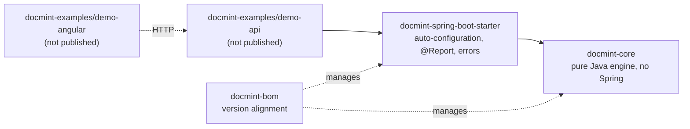
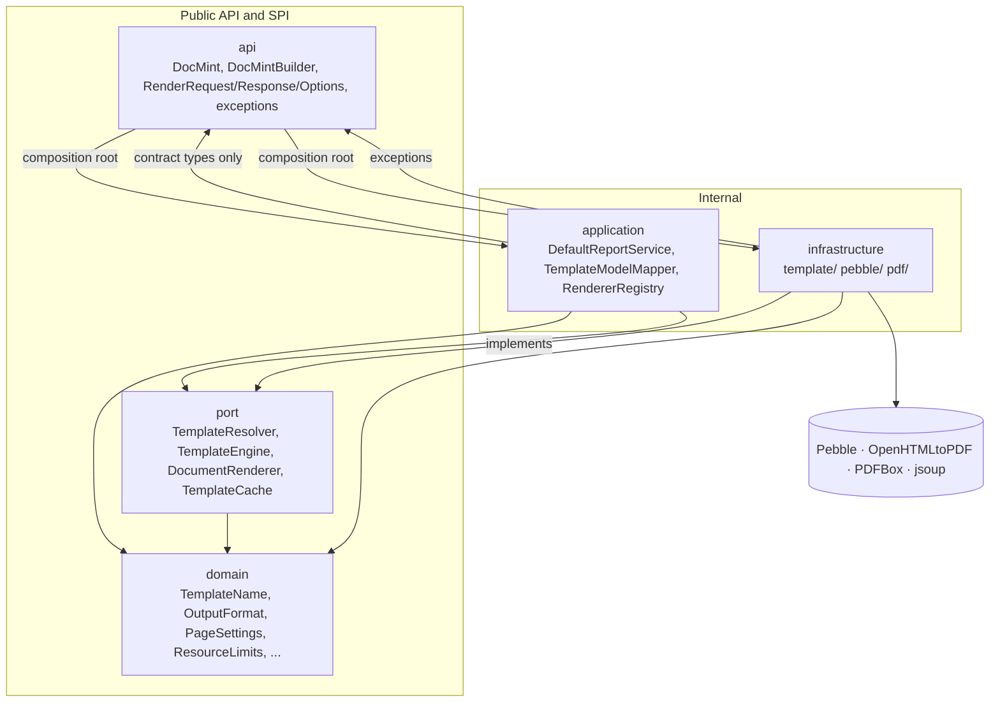
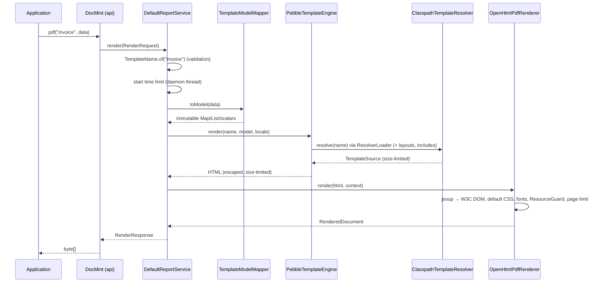

# Architecture

DocMint is a **modular monolith** (Maven multi-module). Inside `docmint-core`, the code follows a
**hexagonal (ports and adapters) architecture**: a small, stable core talks to interfaces
(ports); third-party engines live in replaceable adapters. Decisions are recorded in
[docs/adr](adr/).

## Modules

| Module | Depends on | Published |
|---|---|---|
| `docmint-core` | Pebble, OpenHTMLtoPDF (PDFBox), jsoup, SLF4J API | yes |
| `docmint-spring-boot-starter` | core, Spring Boot 4 (web optional) | yes |
| `docmint-bom` | — | yes |
| `docmint-examples/*` | starter | never |

## Packages of `docmint-core`

Rules enforced by [`ArchitectureTest`](../docmint-core/src/test/java/io/github/juste120/docmint/architecture/ArchitectureTest.java):

1. `domain` depends only on the JDK.
2. `port` depends only on `domain`.
3. `application` depends on `domain`, `port` and the `api` contract types (records, exceptions),
   never on `DocMint`/`DocMintBuilder`.
4. Only `infrastructure` imports Pebble, OpenHTMLtoPDF, PDFBox or jsoup.
5. `infrastructure` does not depend on `application` nor on the façade.
6. Nothing in core depends on Spring.
7. Public packages never expose infrastructure types (except the composition root).

`application` and `infrastructure` are **internal**: public Java classes (wiring across
packages requires it) but excluded from the Javadoc and without compatibility guarantee
([ADR-0005](adr/0005-packages-and-public-surface.md)).

## Render pipeline

## Security design

| Threat | Defence | Where |
|---|---|---|
| Path traversal | `TemplateName` validation for every name (also `extends`/`include`); resources resolved under a private `docmint-classpath:` scheme and checked to stay below the root | `domain.TemplateName`, `pebble.ResolverLoader`, `pdf.ResourceGuard` |
| SSRF | Access control on every resource: class path, `data:` and allow-listed `https` hosts only | `domain.ResourceAccessPolicy`, `pdf.ResourceGuard` |
| XXE | HTML parsed by jsoup (no DTD, no entities) and handed to the renderer as a DOM | `pdf.OpenHtmlPdfRenderer` |
| HTML injection | Pebble auto-escaping (`html` strategy); `raw` is explicit | `pebble.PebbleTemplateEngine` |
| Sandbox escape | Data converted to maps/lists/scalars before rendering; deny-all `MethodAccessValidator`; strict variables | `application.TemplateModelMapper`, `pebble.DenyAllMethodAccessValidator` |
| Resource exhaustion | Template size, rendered size, page count (checked page by page), render time; recursion guard | `domain.ResourceLimits`, `pdf.PageLimitingSupplier`, `application.TimeLimiter` |
| Information disclosure | Messages without paths/stack traces/data; RFC 9457 bodies | `api` exceptions, `spring.web.DocMintProblemDetailsHandler` |

## Spring Boot starter

- `DocMintAutoConfiguration` builds the `DocMint` bean from `DocMintProperties`
  (`@ConditionalOnMissingBean`).
- `DocMintWebAutoConfiguration` (servlet + Spring MVC only) registers `ReportReturnValueHandler`
  **first** in `RequestMappingHandlerAdapter` (custom handlers added through `WebMvcConfigurer`
  would run after `@ResponseBody` handling) and `DocMintProblemDetailsHandler`.

## Extending DocMint

Future formats (Excel, Word, …) are new `DocumentRenderer` adapters registered per
`OutputFormat` (Strategy pattern, open/closed principle): the application core does not change.
Experts can already plug their own `TemplateResolver` or `DocumentRenderer` through
`DocMintBuilder`.
